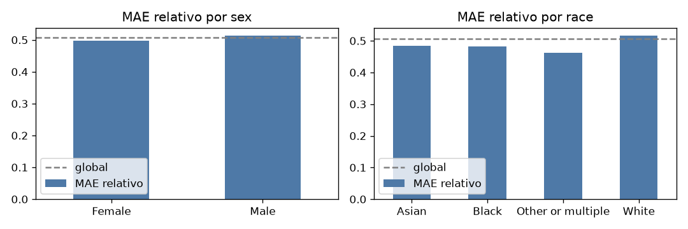
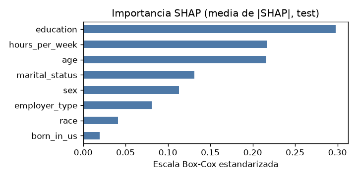

# Detalles del modelo

- **Nombre:** Predicción de sueldo anual (Census income)
- **Versión:** 1.0
- **Fecha:** 16/10/2026
- **Responsable:** Tatiana Duran (a2521)
- **Tipo de modelo:** regresión lineal (`LinearRegression`) dentro de un `Pipeline`, con la target transformada con Box-Cox (λ = 0.21) mediante `TransformedTargetRegressor`
- **Preprocesamiento:** imputación (mediana en numéricas, moda en categóricas), estandarización de numéricas y one-hot de categóricas, todo ajustado solo con datos de entrenamiento

# Propósito

Estimar el sueldo anual de una persona a partir de variables demográficas y laborales. Es un modelo con fines académicos (Actividad 4, Análisis de Datos II), pensado para practicar feature engineering, prevención de data leakage y auditoría de sesgos.

# Entradas y salidas

- **Entradas (8 variables):**
  - Numéricas: `age`, `hours_per_week`
  - Categóricas: `education`, `employer_type`, `marital_status`, `sex`, `race`, `born_in_us`
  - Admite valores faltantes en las entradas (se imputan dentro del pipeline).
- **Salida:** sueldo anual estimado en pesos (`income`), siempre positivo. El modelo predice en escala Box-Cox y devuelve el valor ya convertido a pesos.

# Datos

- **Origen:** dataset Census income (10,000 registros).
- **Partición:** 8,000 para entrenamiento (con k-fold de 5 folds) y 2,000 para test, separados antes de cualquier transformación.
- **Valores faltantes:** `hours_per_week` (500), `education` (300), `employer_type` (400).
- **Variables sensibles analizadas:** `sex` y `race`.

# Métricas de desempeño

Validación cruzada (5 folds sobre el train) y evaluación final sobre el conjunto de test. El MAE y el RMSE están en pesos.

|     Metric     | Value |
| :------------: | :---: |
|    MAE test    | 27467 |
|   RMSE test    | 57463 |
|    R² test     | 0.228 |
| R² CV (media)  | 0.252 |
| R² CV (desvío) | 0.035 |

# Métricas por subgrupo

Métricas calculadas con Fairlearn (`MetricFrame`) sobre el conjunto de test. El **MAE relativo** (MAE / sueldo medio del grupo) permite comparar grupos con niveles de sueldo distintos.

## sex

| sex    |    n |   MAE |   MAE relativo |   Error medio (pred - real) |
|:-------|-----:|------:|---------------:|----------------------------:|
| Female | 1008 | 22127 |          0.498 |                       -9291 |
| Male   |  992 | 32893 |          0.513 |                      -12616 |

## race

| race              |    n |   MAE |   MAE relativo |   Error medio (pred - real) |
|:------------------|-----:|------:|---------------:|----------------------------:|
| Asian             |   90 | 26838 |          0.484 |                       -9862 |
| Black             |  476 | 19262 |          0.483 |                       -6520 |
| Other or multiple |   77 | 19032 |          0.462 |                       -6872 |
| White             | 1357 | 30865 |          0.515 |                      -12793 |

## Conclusión

El MAE relativo de todos los grupos está dentro de ±20% del global (0.51): el modelo se equivoca en una proporción similar con todos. El MAE en pesos es mayor en hombres y en personas blancas porque sus sueldos son más altos y dispersos. Todos los grupos están subestimados (error medio negativo), efecto de la transformación Box-Cox.

## Gráfico

# Explicabilidad

Valores SHAP (`LinearExplainer`) agrupando las dummies de cada variable original. `sex` ocupa el puesto 5 y `race` el puesto 7 de 8 en importancia. En promedio, `sex` baja la predicción de las mujeres (-0.13) y sube la de los hombres (+0.09): el modelo usa la variable sensible directamente.

## Importancia SHAP

# Limitaciones de uso

- **Reproduce la brecha salarial histórica:** predice en promedio $35,123 para mujeres y $51,555 para hombres, en parte por usar `sex` y `race` como predictores directos.
- **No usar para decisiones sobre personas** (fijar salarios, aprobar créditos, selección de personal): perpetuaría las desigualdades presentes en los datos.
- **Capacidad predictiva limitada:** R² ≈ 0.23; el error absoluto medio es de $27,467.
- **Subestima los sueldos altos:** por la transformación Box-Cox, la predicción se acerca a la mediana y no a la media.
- **Grupos chicos:** las métricas de `race` = Asian y Other or multiple se basan en menos de 100 casos del test.
- **Proxies:** quitar `sex` y `race` no garantiza eliminar el sesgo, porque variables como `marital_status` pueden estar correlacionadas con ellas.
- **Rango de validez:** edades entre 17 y 92 años; no se garantiza el desempeño en poblaciones distintas a la de entrenamiento.
